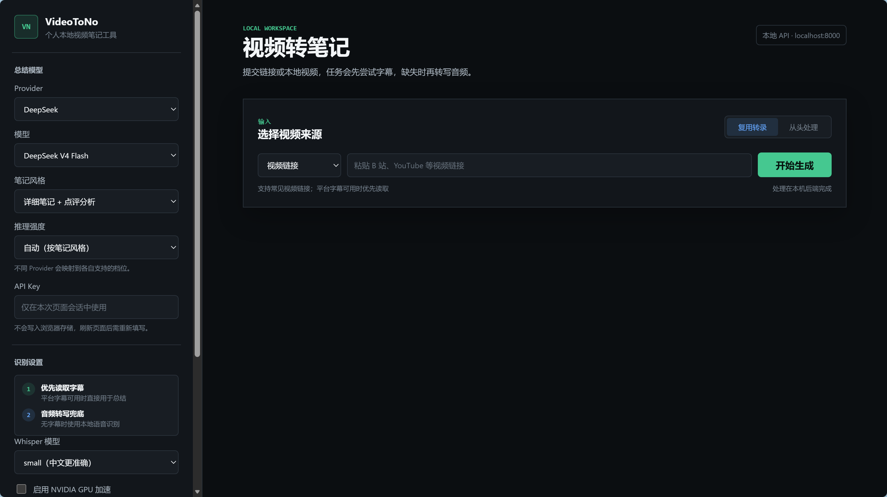
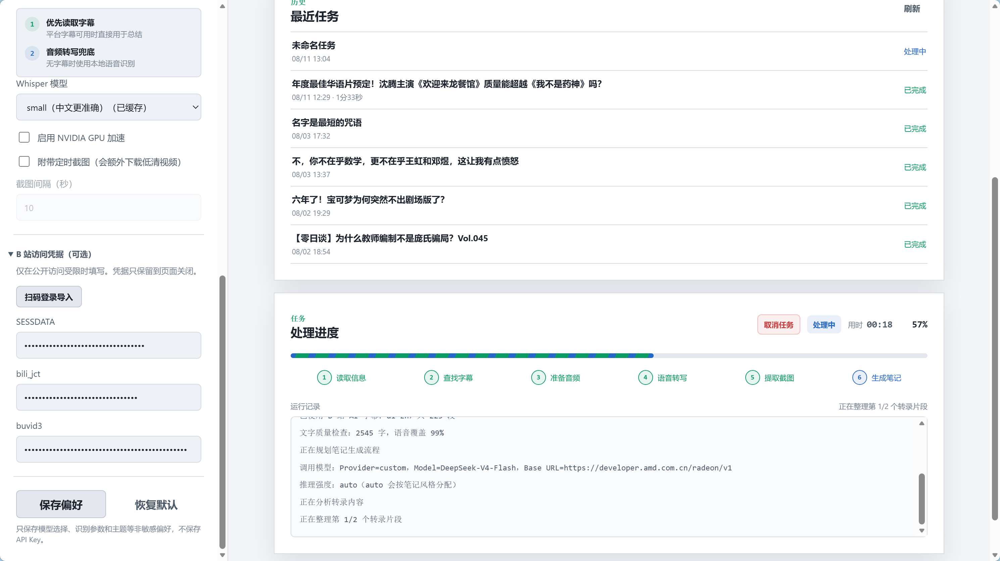
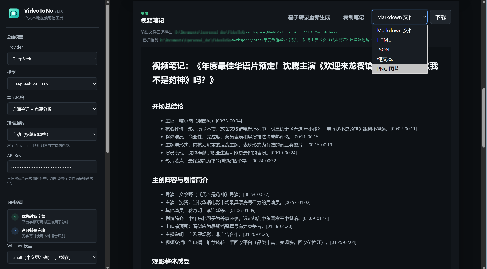

<p align="center">
  
</p>
<h1 align="center">VideoToNo v1.4.7</h1>

<p align="center"><em>把视频变成可回看的 Markdown 笔记</em></p>

<p align="center">🌐 <a href="README.md">简体中文</a> · <a href="README_EN.md">English</a></p>

<p align="center"><span style="white-space: nowrap;"><a href="https://github.com/like-attract/video-to-note/actions/workflows/ci.yml"></a>&nbsp;<a href="https://github.com/like-attract/video-to-note/releases/latest"></a>&nbsp;<a href="LICENSE"></a>&nbsp;&nbsp;&nbsp;</span></p>

<p align="center"><a href="https://github.com/like-attract/video-to-note/releases/latest"><strong>⬇️ 下载 Windows 便携版</strong></a></p>

<p align="center">🎬 宣传视频：<a href="https://www.bilibili.com/video/BV1Qwby6DEu1/">https://www.bilibili.com/video/BV1Qwby6DEu1/</a> &nbsp;·&nbsp; 👥 QQ 交流群：<code>739200648</code></p>

VideoToNo 把「视频 → 结构化笔记」这条链路做成了一个**本地优先**的服务：输入 B 站、抖音、YouTube 链接或本地视频，优先读取平台字幕、B 站 AI 字幕，无字幕时用本机模型离线转写（中文首选 paraformer，也可选 whisper 系），再由你选择的大模型生成带时间轴的 Markdown 笔记。

> 🤖 **Agent Skill 已上线**：把仓库里的 `skills/video-to-note/` 目录复制到 agent 的技能目录（WorkBuddy 是 `C:/Users/用户名/.workbuddy-ai/skills/`，Claude Code / pi 见各自约定），即可一句话生成视频笔记。**Skill 只是遥控器，本机要先有 VideoToNo**（便携版 exe 即可，不用先打开）。WorkBuddy 还能直接接本机 MCP，两条路的装法见下方「MCP / AI 客户端」与「Agent Skill」。详见 `skills/video-to-note/SKILL.md`。

## 🆕 What's New（v1.4.6 → v1.4.7）

- **导出多一种：Word 文档 `.docx`**：结果区的导出菜单多一项「Word 文档 (.docx)」，标题层级、列表、加粗、表格和笔记里的定时截图都带过去，Word / WPS 打开就能继续改
- **选了没下载过的转写模型，不再只能干等**：点「开始生成」时会弹窗说明模型大小，推荐手动导入——直接打开要放文件的文件夹，列出该下哪些文件、下载页在哪；也可以选「自动下载」，弹窗里会显示当前文件已下载多少、共多少。下载失败时同样给出手动导入入口，不会让整条任务陪着失败
- **修：B 站分 P 音频偶发「下载字节数不完整」直接判任务失败**：下载中途断流时会自动改走 B 站播放地址直连，带断点续传和重试，下载完整后才进入转写
- **修：B 站旧登录态失效后没法重新扫码**：以前点「扫码登录导入」会直接从本机浏览器配置里恢复旧账号，旧 cookie 已失效时只能看着任务报「B 站拒绝了本次请求」。现在恢复前会先校验登录态，失效就自动换成干净窗口让你重新扫码；凭据区也新增「重新扫码（换账号）」，随时可以清掉旧登录再扫
- **修：长音频转写偶发卡死**：`large-v3` 跑二十来分钟以上的音频时，进度条停住、日志不再增长、GPU 还在算，任务既不失败也不完成，只能手动取消。原因是工人把整段转录塞在一行 JSON 里回传，超过 asyncio 默认的 64 KB 行上限后读取协程静默退出，主程序再也等不到结果。现在行上限提到 16 MB，读取真失败时也会明确报错并收掉工人，不会再挂住
- **修：长一点的视频笔记只写到一半就停**：笔记停在 36:35、转写一直到 01:03:15 这类情况，现在会识别出「真的丢了结尾」，并按小段把缺失部分补写完整；只是省略时间戳、内容其实写全了的笔记不会被强行重写

<details>
<summary>历史版本摘要（v1.4.6 及更早）</summary>

- **v1.4.6**：字幕可以导出 `.srt`，也可以直接导入 `.srt` / `.vtt` 生成笔记；B 站扫码成功后凭据自动加密存本机，不用每次重扫；agent 发现服务没开时会自己在后台拉起一个无头实例，闲置且无任务时自动退出；修个别电脑上脚本类型被系统登记写坏导致整页按钮失灵的故障。

- **v1.4.5**：长视频与本地小模型更容易一次跑完（中间某次请求被拒不再丢整条任务，碎行先合并再切块）；报错直说是模型上下文窗口不够并给出可操作项；导出的 txt / html / json / PNG 按视频标题命名、B 站分 P 带上 P 号、「仅转录」单独归档成 `标题【转录】.md`；转写跑在独立进程，个别模型库出问题只失败那一次任务；测试连接会自动绕开代理再试一次、侧栏新增「本机自检」；启动时检查新版本，可「忽略本次」。

- **v1.4.2**：内置模型档位跟到各家当前 ID（旧档一条没删，存过的配置照常能用）；「测试连接失败」「B 站取不到内容」「笔记没出正文」三类报错从一串代号改成能照着做的说明；界面文件读不到时给一页可操作说明、标题栏顺手显示本机端口；贴了新链接后按钮回到「开始生成」。

- **v1.4.1**：带截图的笔记导出后不再丢图（Markdown 连截图打包、HTML 自包含，历史任务重新导出即可）；Whisper 档位按本机实测标好「中文推荐 / 不推荐」；`paraformer-zh` 手动导入不再把你领到空文件夹；侧栏新增「让 agent 接入（MCP）」卡；模型报错与运行记录里不再出现明文 API Key。
- **v1.4.0**：长视频笔记改为按时间顺序逐段完整记录（3 小时课不再丢约 2 小时），并自带「内容概览 + 带时间范围的目录」；出稿速度快一个量级（3 小时的课约 10 分钟）；笔记公式在预览与导出的 Markdown 里正常渲染；新增 paraformer-zh / belle-turbo-zh 两种更快的中文转写引擎并调优 CPU 解码；转写每 30 秒回报进度；B 站分 P 提交前显式勾选且沿用上次；模型档案一键重命名；失败提示按平台和阶段说清。
- **v1.3.5**：界面新增「仅转录字幕」输出（全程不调大模型、不需要 Key，字幕稿可一键改走笔记路线）；转录出口同步开放给 MCP / Skill（`transcribe_video` + `get_transcript`）；历史失败任务的字幕稿照样能取；本地视频首次上传即正常（不再必须失败一次重试）、上限真正放开到 2 GB；GPU 缺 CUDA 运行库自动退回 CPU；「待处理」任务可删除。
- **v1.3.0**：API Key 与 B 站凭据按**接口地址**「保存到本机」（Windows 用系统 DPAPI 加密落盘、复用前校验地址、输入框旁新增密钥状态芯片）；模型档案各自记忆所选模型，自定义接口可保存多个命名档案，非敏感设置改动即保存；取消任务在任意阶段秒级生效（实测 18.6s → 0.02s）；修复切换 Provider 时模型 ID 串写、早期失败让任务卡在 `processing`；MCP 新增只读工具 `list_llm_keys`，`save_llm_config` 支持 `label`，`get_saved_config` 增加 `endpoints` / `key_storage`。
- **v1.2.3**：B 站 412 风控自动回退到 `api.bilibili.com` 开放接口（含多分 P 与预览流，Issue #1）、「详细复原」卡在生成阶段的三道护栏、生成进度心跳、推理强度按风格自适应、思考参数被网关拒绝时自动降级并记住结论
- **v1.2.2**：Agent Skill 接入（skills/video-to-note/，一句话生成笔记）、任务完成/失败的 Windows 托盘通知、仓库与文档定位重写
- **v1.2.1**：取消真正立即生效（LLM 流式/下载钩子/模型下载逐块取消）、上传上限 2GB + 超大视频自动提音频、Whisper base 模型导入包
- **v1.2.0**：B 站多分 P 视频（全部/指定分P合并笔记）、语音转写段粒度取消、B 站无字幕误报修正、Whisper 手动导入模型界面
- **v1.1.8**：运行模式与应用版本隔离、最近任务滚动条、详细复原元信息去重、自定义 Base URL 错误诊断
- **v1.1.7**：抖音单条公开分享链接、浏览器验证回退、转写复用和已取消任务删除。
- **v1.1.6**：Whisper 下载确认记忆和自定义工作目录修复。
- **v1.1.5**：旧缓存页面、MCP SSE 和启动告警修复。
- **v1.1.4**：笔记元信息、托盘更新检查、B 站下载稳定性和 Whisper 回退改进。
- **v1.1.3 及更早**：B 站 412 处理、LLM 测试、MCP、任务恢复和多格式导出等基础能力。

</details>


## 🖼️ 界面预览

### ⚙️ 配置与提交

<p align="center"></p>

### ⏳ 处理进度

<p align="center"></p>

### 📝 笔记输出

<p align="center"></p>

## 🚀 便携版下载（推荐）

普通用户无需安装 Python 或配置开发环境，直接下载 [最新 Release](https://github.com/like-attract/video-to-note/releases/latest) 中的 `VideoToNo-1.4.7-portable.exe`：

1. 下载并双击 exe；
2. 等待浏览器自动打开本地页面；
3. 粘贴视频链接或上传本地文件：要成品笔记就先填 Provider、模型和 API Key；**只要带时间轴的字幕稿，选「仅转录字幕」即可，什么都不用填**；
4. 等待生成笔记或字幕稿。

便携版会自动启动本地服务并驻留系统托盘。第一次使用 Whisper / paraformer 转写时会提示下载模型，也可以按界面上的「手动导入模型」指引自己放好文件；生成的任务、转录、截图和笔记默认保存在 exe 同目录的 `workspace/` 中。

## ✨ 主要功能

- 🎥 **多种输入**：B 站、抖音、YouTube、其他可被 `yt-dlp` 解析的视频链接，以及本地音视频文件。
- 🇨🇳 **B 站深度适配**：除常规字幕外，可在登录后读取 B 站 AI 字幕；凭据支持扫码导入；视频页被风控时自动回退到开放接口取信息与音频。
- 🎵 **抖音单链接适配**：支持公开分享链接直接解析；需要验证时可在独立本机浏览器完成登录后重试。
- 🧾 **真实时间轴**：保留字幕或 Whisper 分段的起止时间，不让模型凭空猜时间点。
- 🧠 **长内容整理**：短转录直接生成，长转录自动分块、归并并控制上下文压力；生成后会核对是否写到材料结尾，小缺口自动补写。
- 🖼️ **多格式输出**：Markdown 笔记、HTML、JSON、纯文本和 PNG 图片；可选提取视频截图作为附件。
- 🤖 **给 agent 留了原料出口**：接入的 agent 只要「带时间轴转录」，可以不走大模型、不需要给本机配 API Key，笔记风格由 agent 自己定。
- 🛡️ **本地优先**：媒体下载、转录和文件生成在本机完成；服务默认只监听 `127.0.0.1`。

## 🔁 处理流程

```text
视频链接 / 本地文件
        ↓
平台字幕（B 站 AI 字幕优先）
        ↓ 无可用字幕
faster-whisper 本地转写
        ↓
带时间轴转录 ──────→ 交给 agent 自己写笔记（不调用大模型，无需 API Key）
        ↓
大模型生成带时间轴的 Markdown 笔记
```

## 🌍 支持范围

- B 站、抖音、YouTube，以及当前版本 `yt-dlp` 能解析的其他 `http` / `https` 视频链接；B 站输入支持分享文本、`b23.tv` 短链（可缺省 scheme）与裸 BV/av 号；
- 抖音支持单条公开分享链接；匿名解析受限时，可从页面打开独立的本机抖音浏览器完成登录或验证后重试；
- `.mp3`、`.m4a`、`.wav`、`.flac`、`.aac`、`.mp4`、`.mkv`、`.mov`、`.webm`、`.avi` 等本地媒体；
- 爱奇艺、腾讯视频目前未做专门适配，能否处理取决于平台访问权限、字幕可见性和 `yt-dlp` 的解析能力。

## ⚙️ 使用与配置

启动后按页面提示完成以下操作即可：

1. 选输出类型：**生成笔记**（要配 API Key）或 **仅转录字幕**（只要一份带时间轴的字幕稿，全程不调用大模型、**不需要 API Key**，笔记风格与推理强度这些设置会自动收起）；
2. 生成笔记时选择模型档案并填写 API Key：DeepSeek / OpenAI / 智谱 / 通义 / Kimi 各自记住自己的模型，自定义 OpenAI 兼容接口可以保存多个命名档案，切换档案不会互相覆盖设置；
3. 选择笔记风格、推理强度和 Whisper 模型（推理强度保持 `auto` 时，详细类笔记会用更高思考档，任务日志会打印实际生效档位）；
4. 粘贴视频链接，或切换为本地文件上传；
5. 生成完成后预览、复制或下载结果。字幕稿会留在「最近任务」里（标题前带「转录」标记）随时回看和下载，也可以点「基于字幕稿生成笔记」改走笔记路线——转录不重跑，只补一次大模型调用。

模型档案、识别参数和主题等非敏感设置会自动记在本机浏览器里，改动即生效，不需要手动保存。API Key 默认只留在当前页面内存中，刷新即失效；点「保存到本机」后才会写入 `workspace/llm_keys.json`——Windows 上用系统自带的 DPAPI 加密（换机器或换 Windows 账户就解不开，需要重填），其他平台会明文保存并在界面标注。**已保存的 Key 与接口地址绑定**：只有目标地址与保存时一致才会复用，绝不会发给别的网关。扫码取得的 B 站 Cookie 仍只保留在本机进程内，只有显式保存时才会落盘，请勿分享工作目录里的这些文件。

<details>
<summary>🧑‍💻 源码运行与构建（开发者）</summary>

源码用户直接 `git clone` 或在 GitHub 选择 **Code → Download ZIP** 即可获取完整项目。项目主要面向 Windows + Python 3.11，安装 `backend/requirements.txt` 后可使用 `start.ps1` 启动；需要自行构建便携版时运行：

```powershell
git clone https://github.com/like-attract/video-to-note.git
cd video-to-note
.\.venv\Scripts\python.exe -m pip install -r backend\requirements.txt
.\start.ps1
```

构建 Windows 便携版：

```powershell
powershell -ExecutionPolicy Bypass -File scripts\build_exe.ps1
```

</details>

<details>
<summary>🤖 MCP / AI 客户端（进阶）</summary>

VideoToNo 内置 MCP（Model Context Protocol）服务，可以在 WorkBuddy、Cherry Studio、Codex 等 AI 客户端里直接输入视频链接取字幕稿或生成笔记。**使用前请先启动 VideoToNo**：MCP 工具通过本地后端执行任务，会复用本机的 Whisper 模型缓存和任务目录，不会重复下载。

两条路线按需选：客户端**自己就有模型**时，用 `transcribe_video` + `get_transcript` 只取带时间轴的转录，**不需要给本机配 API Key**，笔记的结构与风格由客户端自己定；要一份现成成品笔记（或超长视频后台跑完）才用 `summarize_video`。

推荐这么用：**先把视频变成文字稿，整理交给客户端**。本服务只负责取字，读法、取舍和成稿结构由你那边的模型决定，所以后续指令可以很宽松：

```text
先把这个视频转成带时间轴的文字稿：https://www.bilibili.com/video/BV1xx
再按你的判断整理：重点把 XXX 那部分讲透，重复的合并，跳步的补上推导，
视频没讲清的地方补充背景和例子，最后给我一份能直接看的稿子。
```

换结构、只深挖某一节、边整理边追问细节都可以，这条路上本机不需要任何 Key，也不会套用固定的笔记模板。要一份现成的标准笔记时才用 `summarize_video`（它需要 Key，风格按所选档位固定）。

可用工具：

| 工具 | 说明 |
|---|---|
| `summarize_video` | 提交视频总结任务；视频链接、API Key、模型和 B 站凭据都可省略，自动复用本机为该接口地址保存的配置 |
| `transcribe_video` | 只做到带时间轴转录为止，全程不调用大模型，**因此不需要 API Key**；适合客户端自己写笔记 |
| `get_transcript` | 取某个任务的转录正文（整篇 markdown 或 json 分段）；历史任务即便后来生成笔记失败，转录照样能取 |
| `wait_for_task` | 等待任务达到终态（最长 45 秒，可重复调用），适合代替频繁轮询；笔记任务会连正文一起返回，转录任务只回状态与提示，正文请用 `get_transcript` 取 |
| `get_task_status` | 查询任务中间进度 |
| `list_whisper_models` | 查看 Whisper 模型的本地缓存状态 |
| `save_llm_config` | 把某个接口地址的 Provider、模型和 API Key 保存到本机（Windows 加密，其他平台明文并提示），之后对该地址调用 `summarize_video` 无需再传 |
| `save_bilibili_credentials` | 把 B 站凭据（SESSDATA 等）保存到本机，与 API Key 同一套本机加密（Windows 加密，其他平台明文并提示），处理 B 站视频时自动使用 |
| `list_llm_keys` | 查看本机已保存密钥的接口地址列表（只返回掩码与加密方式） |
| `get_saved_config` | 查看已保存配置的状态，敏感信息会脱敏显示 |

### WorkBuddy（推荐）

WorkBuddy 有两条接法：**装 Skill 最省事**（不用配 MCP、不用管端口），想让它在对话里像调工具一样直接调就用 MCP。

> 两条路都**不是纯云端**：Skill 和 MCP 都只是「遥控器」，转写、字幕、出笔记全在这台机器上的 VideoToNo 里跑。所以本机得先有程序——没装过就先下 [便携版 exe](https://github.com/like-attract/video-to-note/releases/latest)，放哪个目录都行（**不用先双击打开**，脚本会自己在后台拉起）。

#### 方式一：装 Skill（推荐）

1. 把仓库里的 `skills/video-to-note/` 整个目录复制到 WorkBuddy 的用户技能目录：

```text
C:\Users\<用户名>\.workbuddy-ai\skills\video-to-note\
```

2. 回到 WorkBuddy 新开一个会话（技能在会话启动时加载），确认技能列表里出现 `video-to-note`；
3. 一句话就行：

```text
帮我把这个 B 站视频做成笔记：https://www.bilibili.com/video/BV1xx
```

技能脚本会先扫本机 8000–8019 端口：有服务就直接用，没有就在后台拉一个无头实例（不开浏览器、不进托盘，闲置 15 分钟自动退出）。**第一次它会问便携版 exe 放在哪**，把完整路径给它一次就记住（存在 `%LOCALAPPDATA%\VideoToNo\skill-server-cmd.txt`），也可以事先设环境变量 `VIDEOTONOTES_SERVER_CMD`。技能目录还留在 VideoToNo 仓库里时，它直接用仓库的 `launcher.py` 起，连路径都不用给。

#### 方式二：接 MCP（想在对话里直接调工具时用）

编辑 `C:\Users\<用户名>\.workbuddy-ai\mcp.json`（旧版本可能在 `C:\Users\<用户名>\.workbuddy\mcp.json`；已有其他 server 就并进 `mcpServers`，别整段覆盖）：

```json
{
  "mcpServers": {
    "video-to-note": {
      "type": "sse",
      "url": "http://127.0.0.1:8000/mcp/sse",
      "description": "VideoToNo 本地视频笔记服务"
    }
  }
}
```

保存后打开 WorkBuddy 的「连接器」页，右上角「自定义连接器」里会看到 `video-to-note`，点一次**「信任」**才会真正加载（不点信任不会生效）。之后直接说「用 video-to-note 把这个视频转成文字稿」即可。端口不是 8000 就填实际端口——界面「让 agent 接入（MCP）」卡片里的「复制 JSON 配置」按钮生成的就是这段，只是少了 `description`。

> MCP 连的是「已经在跑的服务」，所以这条路要先把 VideoToNo 打开；Skill 那条路会自己把服务拉起来。两条路跑的任务都在本机，产物进同一个 `workspace/`。

WorkBuddy 自带模型，所以最省事的用法和上面一致：让它走 `transcribe_video` / `--transcript-only` 只取带时间轴的转录，整理和成稿在对话里完成，**本机不需要配 API Key**。

### Cherry Studio（备选，无需本机 Python）

1. 启动 VideoToNo 后，打开 Cherry Studio「设置 → MCP 服务器 → 添加」；
2. 类型选择 **Server-Sent Events (SSE)**，URL 填：

```text
http://127.0.0.1:8000/mcp/sse
```

若服务端口不是 8000，请填写实际端口。保存并启用后，就可以在对话中让 AI 调用 VideoToNo。

首次使用时，建议让 AI 先保存一次配置；之后不必在每次对话中重复提供敏感信息：

```text
请调用 save_llm_config 保存配置：我的 DeepSeek API Key 是 sk-xxx
再调用 save_bilibili_credentials 保存：sessdata=xxx，bili_jct=xxx，buvid3=xxx
```

之后直接描述需求即可：

```text
帮我总结这个 B 站视频：https://www.bilibili.com/video/BV1xx
```

```text
把这个视频转成带时间轴的文字稿就行，我自己整理：https://www.bilibili.com/video/BV1xx
```

后一种说法会让客户端走 `transcribe_video` + `get_transcript`，本机不需要事先保存任何 API Key。

### Codex CLI

支持 stdio 的客户端可运行：

```bash
codex mcp add local videotono -- python -m backend.mcp_server
```

MCP server 会自动扫描 8000–8019 端口来找到已运行的 VideoToNo 服务；也可以用环境变量 `VIDEOTONOTES_BACKEND_URL` 显式指定服务地址。

> 隐私说明：`save_llm_config`（以及网页端的「保存到本机」）把 API Key 写入本机 `workspace/llm_keys.json`——Windows 上用系统 DPAPI 按当前用户加密，把该文件拷到另一台机器或另一个 Windows 账户都解不开；非 Windows 平台没有 DPAPI，会明文保存并在界面标注。Key 与保存时的接口地址绑定，只有目标地址一致才会复用。`save_bilibili_credentials` 保存的 SESSDATA / bili_jct 走同一套信封加密写入 `workspace/bili_credentials.json`（同样绑定当前 Windows 账户，换机器需重新保存；`buvid3` 是设备标识，客户端本就明文携带，故保持明文）。未显式调用保存工具时，凭据不会落盘；`workspace/` 已被 `.gitignore` 排除，不会进入 Git 仓库，也请勿分享这些文件。

</details>

<details>
<summary>🧩 Agent Skill（进阶）</summary>

除了 MCP，VideoToNo 也提供 **Agent Skill**（`skills/video-to-note/`），供 WorkBuddy、Claude Code、pi 等支持技能的 agent 使用：agent 读取 `SKILL.md` 后，会自动调用本仓库附带的脚本完成「提交任务 → 轮询进度 → 取回笔记」全流程。**本机服务没在跑时脚本会自己后台把它拉起来**（不开界面、不进托盘，闲置一刻钟自动退出），第一次只需告诉 agent 便携版 exe 放在哪；任务与 MCP 相同，都由本地后端执行。

### 安装

Skill 本身不含转写引擎，只是个「遥控器」：**本机要先有 VideoToNo**（[便携版 exe](https://github.com/like-attract/video-to-note/releases/latest) 或这份源码仓库），但不用先启动它。然后把 `skills/video-to-note/` 整个目录复制到 agent 的技能目录，例如：

```text
C:\Users\<用户名>\.workbuddy-ai\skills\video-to-note\   # WorkBuddy
C:\Users\<用户名>\.agents\skills\video-to-note\          # pi / 通用约定
~/.claude/skills/video-to-note/                          # Claude Code
```

### 使用

安装后直接对 agent 说一句话即可：

```text
帮我把这个 B 站视频做成笔记：https://www.bilibili.com/video/BV1xx
```

```text
先把这个视频转成带时间轴的文字稿，再按你的判断整理：重点讲透 XXX，
重复的合并，视频没讲清的地方补充背景，最后存成 notes.md：https://www.bilibili.com/video/BV1xx
```

agent 会调用技能附带的 `scripts/video_note.py`，自动探测服务端口（不通就后台拉起）、提交任务、实时打印运行日志，完成后输出（或保存）结果。后一种说法会走 `--transcript-only` 取原料，本机不需要任何 API Key，拿到文字稿之后的取舍、补背景、换结构都由 agent 自己完成，提示词不必写得很具体。常用参数：`--transcript-only`（只要带时间轴转录，不调用大模型）、`--style detailed|faithful|concise`、`--wait 秒数`、`--out 文件路径`、`--server-cmd "<便携版 exe 路径>"`（服务没在跑时用它启动，给一次会记住）；本地视频文件路径也可直接作为输入。

> **agent 自带模型时优先用 `--transcript-only`**：这条路线完全不调用大模型，因此不需要 API Key，转录到的内容由 agent 自己组织成笔记，不受内置笔记模板约束。只有需要一份现成成品笔记时才走 `--style`，而那需要大模型 API Key：agent 会向你要，用 `--provider` / `--api-key` 传入；若本机只为一个接口地址保存过 Key（网页端「保存到本机」或 MCP 的 `save_llm_config`），省略这些参数即可直接复用，不需要再传。

</details>

<details>
<summary>❓ 常见问题</summary>

### 首次转写为什么等待很久？

`faster-whisper` 会在第一次使用某个模型时下载模型文件。下载耗时取决于模型大小和网络状况，后续会复用本机缓存；切换到另一个模型时仍可能再次下载。

模型默认缓存在 `workspace/_model_cache/`。如需改到其他磁盘，可在 `.env` 中设置 `WHISPER_CACHE_DIR`。下载默认走 **hf-mirror.com 镜像**，支持断点续传和重试；如需切换，可设置 `HF_ENDPOINT`，例如 `HF_ENDPOINT=https://huggingface.co` 使用官方源。若仍失败，请检查网络、代理和缓存目录写入权限。

应用默认禁用 Hugging Face Xet 下载后端，改用普通 HTTP 下载，以减少部分 Windows 网络下的 CAS 文件重建错误。如果所选模型尚未完整缓存、但本机已有可用的 `base`，任务会降级到 `base` 并在运行日志中注明，避免长期卡在不稳定的权重下载上。

### 大模型（medium 及以上）下载反复失败怎么办？

大模型体积大（medium 约 1.5GB），网络不佳时容易中断。除了重试（支持断点续传），推荐手动导入：

1. 在「语音转写」设置中选择目标模型，点击「**手动导入模型**」按钮，弹窗会列出该模型需要哪几个文件、去哪个页面下载，确认后程序自动打开导入文件夹（`workspace/_model_cache/manual/<模型名>/`）；
2. 用浏览器（或下载工具）按弹窗里的下载页保存这些文件：`config.json`、`model.bin`、`tokenizer.json`，加上词表文件 `vocabulary.txt` 或 `vocabulary.json`（各仓库用的名字不一样，例如 `large-v3` 只提供 `.json`，页面上有哪个就下载哪个，点开每个文件右上角的下载箭头）；
3. 把这些文件原样放入打开的文件夹，程序几秒内自动识别，下拉框会显示「已缓存」。

程序会对下载和缓存做完整性校验；检测到历史中断留下的损坏文件时会自动清理并重新下载，无需手动删除缓存。

### CPU 转写为什么比视频时长还久？

速度取决于 CPU、视频时长和模型大小。CPU 模式使用 `int8` 降低资源压力，但 `medium`、`large-v3` 和 `turbo` 仍可能较慢并占用较多内存。个人电脑建议先使用 `base`；确认 CUDA 环境可用后再启用 GPU。

### 为什么需要 B 站 Cookie？

公开且可直接访问的视频通常不需要 Cookie。部分播放器可见的中文 AI 字幕只会在登录态字幕接口中返回；未填写凭据时，程序会记录提示并回退到 Whisper。登录可见、访问受限或字幕接口受限的视频可能需要当前账号凭据，但 Cookie 不能绕过账号本身没有的权限。凭据过期后需重新获取，平台策略变化也可能导致解析失败。

### 重启服务后任务会怎样？

VideoToNo 会从 `workspace/<task-id>/task.json` 恢复最近任务。已完成任务可继续预览和下载；上传后尚未开始的任务可重新提交。重启时仍在运行的任务会标记为失败，因为外部下载、Whisper 或大模型请求无法跨进程续跑；已经生成的字幕、转录和音频仍可在重新提交时复用。

### 为什么某个链接无法处理？

先确认链接能在当前网络和账号下正常播放，再更新项目依赖中的 `yt-dlp`。付费内容、DRM、验证码、地区限制、临时签名失效或平台接口变化都可能阻止解析；项目不会绕过平台权限控制。

### 没有字幕时会发生什么？

应用会下载该链接可取得的最佳音频，并在本机运行 `faster-whisper`。这比直接读取字幕耗时更多，也会受到音质、口音、背景噪声和专业术语的影响。

### 为什么会提示“模型未返回正文，已关闭深度思考并重试”？

这表示模型这一次真实返回了空正文，并非仅仅是界面显示问题。应用会立即在当前生成阶段提示，并自动关闭深度思考重试一次；若重试后仍无正文，任务会按实际错误状态处理。

### B 站视频页无法访问时为什么任务还在继续？

部分网络环境下 B 站视频网页会被风控拦截（`HTTP 412`），而 `api.bilibili.com` 开放接口仍可用。应用会自动改用接口直连取视频信息与音频（多分 P 与预览截图同样覆盖），运行日志会写明“已改用开放接口直连”，不需要重新提交。项目不会绕过平台权限控制：登录可见、会员专属内容仍需有效凭据。

### 为什么进度会停在“模型正在深度思考”一段时间？

详细笔记与详细复原默认使用更高思考档，长视频可能几分钟只产生思考链。界面每 20 秒会刷新一次“正在深度思考（已累计 N 字）”或“模型已输出 N 字”，说明任务仍在推进；若希望更快或更省 Token，可把推理强度显式改为“关闭深度思考”或“高”。任何时候都可以取消任务，已生成的转录会被保留。

### 大模型报 400 `unsupported_parameter`（`thinking` / `reasoning_effort`）怎么办？

不同 OpenAI 兼容通道对「思考控制参数」的支持差别很大：有的只认标准的 `reasoning_effort`，收到厂商私有的 `thinking` 字段就直接 400。应用现在**默认只发标准参数**（私有的 `thinking` 仅用于官方 DeepSeek 关闭思考），并且真的被拒时会自动降级重试：`reasoning_effort` → 嵌套 `reasoning.effort` → 不注入（用模型默认思考）；同理，当我们为思考链抬高的 `max_tokens` 超过网关上限时，也会自动退回笔记长度甚至不下发该参数。日志会写明「该通道不支持 xxx 参数」。若想跳过「第一次先失败」的那一次请求，可用环境变量直接声明通道能力（逗号分隔，可取 `thinking` / `reasoning_effort` / `reasoning` / `enable_thinking`）：

```powershell
$env:VIDEOTONOTES_REJECTED_LLM_PARAMS = "thinking,reasoning_effort"
```

</details>

## 🎬 宣传视频与交流群

- 🎬 宣传视频（B 站）：<a href="https://www.bilibili.com/video/BV1Qwby6DEu1/">BV1Qwby6DEu1</a>
- 👥 QQ 交流群：<code>739200648</code>（欢迎反馈问题、提建议、获取模型附件）

## 📄 开源许可

这是一个面向本地个人使用的工具，采用 [MIT License](LICENSE) 开源。
